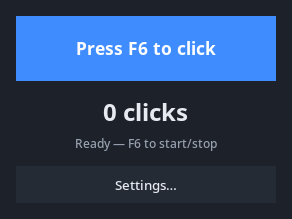
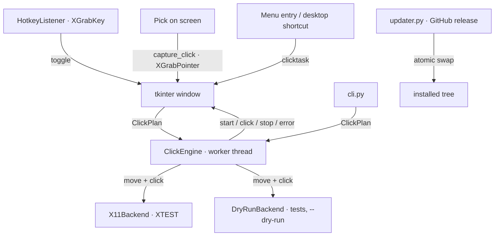

# 🖱️ ClickTask — Interval Auto Clicker for X11

> 👤 More projects: [@JADRT22](https://github.com/JADRT22) — LinuxTask • Hyprland automation • Roblox on Linux • MCP/agents

**An interval auto clicker for X11, modelled on GS Auto Clicker: set a rhythm, press F6, and it clicks — at the cursor or at a pinned point.**

[](https://github.com/JADRT22/ClickTask/releases)
[](https://github.com/JADRT22/ClickTask/actions/workflows/python-app.yml)
[](LICENSE)
[](https://github.com/JADRT22/ClickTask/stargazers)

ClickTask clicks for you at a fixed interval, at the cursor or at a point you
pick with the mouse, and can replay an ordered list of points in a loop. It
never records your keyboard — that is
[LinuxTask](https://github.com/JADRT22/LinuxTask)'s job. The two are
complements: one plays back what you did, the other repeats one action at a
rhythm you choose.



## Copy-paste in 30s

```bash
git clone https://github.com/JADRT22/ClickTask.git && cd ClickTask && ./install.sh
```

The installer puts **ClickTask** in the application menu (so it shows up in the
search bar), adds a shortcut to your desktop and creates the `clicktask`
command. Open it from any of them and press **F6** to start and stop; the whole
window shows every option in plain sight, like OP Auto Clicker.

## Table of contents

- [Why another clicker](#why-another-clicker)
- [Roadmap](docs/ROADMAP.md)
- [Features](#features)
- [Status](#status)
  - [Known limitations](#known-limitations)
- [How it works](#how-it-works)
- [Getting started](#getting-started)
  - [Requirements](#requirements) · [Install](#install) · [Run](#run)
- [Updates](#updates)
- [Usage](#usage)
  - [GUI](#gui) · [Picking a point](#picking-a-point) · [Hotkey](#hotkey) · [CLI](#cli) · [Sequence file](#sequence-file-format)
- [Security model](#security-model)
- [Development](#development)
  - [Project layout](#project-layout) · [Tests](#tests) · [Release process](#release-process)
- [Troubleshooting](#troubleshooting)
- [FAQ](#faq)
- [Uninstall](#uninstall)
- [Contributing](#contributing)
- [License](#license)

## Why another clicker

TinyTask records and replays a whole session, keyboard included; GS Auto
Clicker keeps clicking a spot at a set rhythm. ClickTask follows the second
model, with a CLI, point sequences and a signature-verified self-update, on
Linux/X11. If you want "replay what I did", use
[LinuxTask](https://github.com/JADRT22/LinuxTask).

Full comparison: [docs/COMPARISON.md](docs/COMPARISON.md).

## Features

- **Interval control** — hours / minutes / seconds / milliseconds fields, 1 ms floor.
- **Click options** — left, middle or right button; single or double click;
  optional hold per press.
- **Repeat** — click until stopped or exactly N times, with a live counter.
- **Click-to-pick targeting** — press *Pick on screen*, then click the spot you
  want; that click becomes the fixed point (Esc cancels).
- **Click sequences** — ordered points, each with its own delay, button and
  double-click flag, looped forever or a set number of times.
- **Global hotkey** — F6 by default, configurable; one press starts, the next stops.
- **Headless CLI** — the same engine from a script, with `--dry-run` to preview
  the plan without moving the pointer.
- **Persistent settings** — everything is remembered between runs.
- **Everything on one window** (OP Auto Clicker layout) — click plan, interval
  with jitter, click options, repeat mode, cursor position and the sequence
  panel side by side, over a dark card with a fade-in, a pulse while running
  and a counter that pops on each click.
- **Installs like an app** — one user-level installer adds a menu entry (found
  by the desktop search bar), a desktop shortcut, the icon and a `clicktask`
  command; no sudo and no system directories.
- **Self-update** — installed builds check GitHub on startup and every day, so a
  published release replaces the code by itself; the venv and your settings are
  kept.
- **One window per session** — launching ClickTask again brings the running
  window forward instead of starting a second clicker.
- **`clicktask doctor`** — checks Python, tkinter, python-xlib, the X display,
  the hotkey/keycode, shortcuts, the update timer and the settings path.

## Status

This README describes v1.3.0 (`VERSION` in `src/version.py`).

| Area | Support level |
|---|---|
| X11 desktops (XFCE, Cinnamon, MATE, i3, Openbox…) | **Supported.** Pointer capture verified by the author on a live X11 session; click injection covered by unit tests against a mocked X display |
| Global hotkey (`XGrabKey`) | Supported, with CapsLock/NumLock variants |
| Fixed position and click sequences | Supported, covered by engine tests |
| `--dry-run` CLI | Supported, usable without a display |
| Wayland (any compositor) | **Not supported** — `XTEST` cannot reach Wayland clients |
| Keyboard automation / macro recording | **Not supported** — use [LinuxTask](https://github.com/JADRT22/LinuxTask) |

### Known limitations

- **X11 only.** On a Wayland session the app can open (XWayland) but its clicks
  will not reach native Wayland windows.
- **One screen, no coordinate offsets.** Positions are root-window coordinates
  of the default screen; multi-monitor setups work only when the screens share
  the X root window, which is the usual XFCE arrangement.
- **1 ms is nominal.** The X server and the target application bound the real
  click rate; below roughly 5 ms you are measuring your machine, not the
  setting.
- **The hotkey can be taken.** If another application already owns F6, the grab
  fails; ClickTask says so and the CLI still works.
- **The picker needs the pointer.** While picking, ClickTask grabs the pointer
  for up to 60 s; another tool holding it at that moment produces an error
  instead of a silent failure.
- **Double-click gap is fixed** at 40 ms between the two presses.

## How it works



- **Engine**: a single worker thread schedules clicks against
  `time.monotonic()`. If the system stalls and the next slot is already past,
  the click happens immediately and the schedule re-anchors — a slow moment
  never turns into a burst of catch-up clicks.
- **Backends**: `X11Backend` injects presses/releases and pointer warps through
  `XTEST`; `DryRunBackend` records the actions so tests, CI and `--dry-run`
  never touch the pointer.
- **Hotkey**: `XGrabKey` on the root window with the CapsLock/NumLock
  variants, on its own X connection (python-xlib objects must not be shared
  between threads). Auto-repeat is filtered, so one physical press is one
  toggle.
- **Picker**: `XGrabPointer` takes the next click away from whatever is under
  the cursor and reports its coordinates, so picking a point never activates
  anything.
- **GUI**: builds a `ClickPlan` from the settings and shows engine state; it
  never injects input itself. Animations and the counter are polled with
  `after()`, keeping every tkinter call on the main thread.

## Getting started

### Requirements

- Python ≥ 3.10 with Tk (`python3-tk` / `tk`)
- `python-xlib` (installed by `./install.sh` into the app's own venv, pinned in
  `requirements.txt`)
- A running X11 session (`$DISPLAY`)
- Tkinter is needed for the GUI only; the CLI works without it

### Install

```bash
git clone https://github.com/JADRT22/ClickTask.git
cd ClickTask
./install.sh
```

`./install.sh` copies the app to `~/.local/share/clicktask`, creates its venv,
installs `python-xlib`, then registers everything a desktop app needs:

| What | Where |
| --- | --- |
| `clicktask` launcher | `~/.local/bin/clicktask` |
| menu entry (search bar) | `~/.local/share/applications/clicktask.desktop` |
| desktop shortcut | your XDG desktop folder, e.g. `~/Desktop/ClickTask.desktop` |
| icon | `~/.local/share/icons/hicolor/…/clicktask.svg` + 64px PNG |
| daily update timer | `~/.config/systemd/user/clicktask-update.{service,timer}` |

Options: `--prefix DIR` (install elsewhere), `--no-desktop` (skip the desktop
shortcut), `--no-autoupdate` (no timer). Nothing needs root: no packages, no
system directories, no udev rules. The canonical scripts live in `tools/`
(`install.sh`, `run.sh`, `update.sh`, `uninstall.sh`); the root `install.sh` and
`run.sh` are thin wrappers, so `./run.sh click --help` works from the checkout.

Manual setup, if you prefer your own Python:

```bash
sudo pacman -S tk          # or: sudo apt install python3-tk
pip install python-xlib    # or: pip install -r requirements.txt
python3 src/main.py        # GUI
python3 src/cli.py --help  # CLI only
```

### Run

```bash
clicktask                  # GUI, from the installed launcher
clicktask --help           # CLI help
tools/update.sh --check    # is there a newer release?
./run.sh                   # GUI straight from the checkout
./run.sh click --count 10 --interval 100ms
```

The menu entry, the desktop shortcut and the `clicktask` command all run the
same installed copy.

## Updates

Installed builds update themselves from
[GitHub releases](https://github.com/JADRT22/ClickTask/releases):

- **On startup** — the GUI checks in the background and, when a newer tag
exists, downloads and installs it. The result is cached for an hour
(`$XDG_CACHE_HOME/clicktask/update.json`), so relaunching does not burn GitHub's
unauthenticated rate limit; *Check now* always queries the network. The window
then says *Updated to vX.Y.Z — restart ClickTask*.
- **Every day** — the systemd user timer `clicktask-update.timer` runs
`clicktask update --quiet`, so the files are current even if you never open the
app.
- **On demand** — `clicktask update --check` reports the versions,
`clicktask update` installs, `clicktask update --force` reinstalls the latest
release, `clicktask update --to vX.Y.Z` installs a specific one and
`clicktask update --rollback` restores the tree replaced by the last update (no
network needed).

The update downloads the release tarball to a temporary directory and checks
the published `SHA256SUMS` before anything is unpacked; when the release also
carries `SHA256SUMS.sig`, that signature must match the key pinned in
`src/release_key.py`, so a compromised GitHub account alone cannot push code.
It then checks that the archive contains `src/main.py` and that no entry escapes
the folder, and only then swaps `src/`, `tools/`, `docs/` and `assets/` in place. Your `.venv`, settings and
shortcuts are preserved; if `requirements.txt` changed, the dependencies are
reinstalled inside the venv. Old modules the release removed disappear with the
swap. The replaced tree is kept in `.previous` until the next update, which is
what `--rollback` restores.

Turn it off with the **Auto-update** checkbox in the window footer, or skip
the timer with `./install.sh --no-autoupdate`. `CLICKTASK_NO_UPDATE=1`
disables the startup check for a single run. Auto-update never runs from a git
checkout: only trees created by the installer are touched, so development is
safe.

## Usage

### GUI

All controls are on the main window, in OP Auto Clicker order:

- **Click plan: Clicker / Sequence** — what Start (F6) runs.
- **Click interval** — h/m/s/ms fields (1 ms floor) plus **Jitter ± ms**, a
  uniform random offset applied to each interval, so the rhythm is not machine-
  gun-stable.
- **Click options** — button (left/middle/right), single/double and the hold
  per press.
- **Click repeat** — repeat until stopped, or exactly N times.
- **Cursor position** — click wherever the cursor is, or pin a **Fixed point**
  with *Pick on screen*.
- **Sequence** — the ordered point list (hidden behind *Show list* until you
  want it), its loop count, an optional click cap, and the picker. Select a row
  and press **Edit…** (or double-click it) to change its X/Y, delay, button,
  double-click and per-point hold; **↑ Up** and **↓ Down** reorder,
  **Duplicate** copies the row below it, and **Import…** / **Export…** read and
  write the same JSON format as the CLI.
- **Start (F6) / Stop (F6)** — the highlighted blue button starts; it stops on
  F6, on the button, or when the cap is reached, and the status line always
  says where the run clicks and how many clicks it made.
- **Footer** — the toggle-hotkey field with **Apply**, the auto-update
  checkbox, *Check updates* and the version label.

### Picking a point

Picking does not read the cursor position on the spot. Press **Pick on screen**
(Cursor position) or **Pick…** (Sequence); a toast asks for a
 click, and *that click* becomes the coordinate:

- the click is grabbed, so nothing behind the cursor is activated;
- **Esc** cancels;
- the pick times out after 60 s;
- if the pointer is already grabbed by another tool, you get an error dialog.

### Hotkey

`F6` toggles clicking from any window. Change the name in the **Toggle hotkey**
field of the footer and press **Apply**. Keys already owned by another
application cannot be grabbed; the status line reports it and the CLI remains
usable.

### CLI

```bash
# 50 left clicks, one every 100 ms, at a fixed point
./run.sh click --interval 100ms --count 50 --at 800,600

# right-click forever until Ctrl+C, wherever the cursor is
./run.sh click --interval 250ms --button right

# double clicks, 10 ms hold each, every 1.5 s, 20 times
./run.sh click --interval 1.5s --count 20 --double --hold 10

# preview the plan without touching the pointer
./run.sh click --interval 100ms --count 5 --at 400,300 --dry-run

# replay a point sequence, 3 loops
./run.sh seq points.json --interval 200ms --loops 3
```

Flags: `--interval` (`100`, `100ms`, `1.5s`, `2m`, `1h`), `--count` (0 =
unlimited), `--button` (`left|middle|right`), `--double`, `--hold MS`, `--at
X,Y`, `--dry-run`, `--display`.

Exit codes: `0` ok, `1` no usable X display, `2` invalid arguments or plan,
`130` interrupted with Ctrl+C.

### Sequence file format

```json
[
  { "x": 400, "y": 300, "delay_ms": 200 },
  { "x": 900, "y": 300, "delay_ms": 500, "button": "right", "double": true }
]
```

A JSON list of points, or the same list under a `points` key. Fields: `x`, `y`
(required), `delay_ms` (0 inherits `--interval`), `button` (empty inherits the
default), `double`, `hold_ms`.

## Security model

- **No root, no device nodes.** Everything goes through the X server as your
  own user; there is no `uinput`, no `evdev` and no privileged helper.
- **One outbound request, only for updates.** Clicking never opens a socket.
  Installed builds read the latest release from `api.github.com` on startup and
  once a day, then download the release tarball and its `SHA256SUMS` from
  GitHub; a signed release is verified against the pinned public key, the
  archive layout is verified before any file is replaced and symlinks are
  rejected. Turn it off with the **Auto-update** checkbox in the footer or at install time. Locally, the only files written are
  `$XDG_CONFIG_HOME/clicktask/config.json` and the install folder.
- **Grabs are short and visible.** The hotkey grabs one key on the root
  window; the picker grabs the pointer only while a pick is open (Esc cancels,
  60 s timeout) and releases it in a `finally` block.
- **Input is local to your session.** `XTEST` events carry no privileges and
  cannot be sent to another user's display.

## Development

### Project layout

| Path | Purpose |
| --- | --- |
| `src/engine.py` | `ClickPlan`/`Point` + `ClickEngine` worker (interval + sequence modes) |
| `src/backend.py` | `X11Backend` (XTEST), `DryRunBackend`, `capture_click` picker |
| `src/hotkey.py` | `XGrabKey` listener with lock-modifier variants |
| `src/config.py` | Defaults, validation, atomic load/save |
| `src/cli.py` | Argument parsing, interval/point/sequence parsing, exit codes |
| `src/gui.py` | tkinter main window (OP-style panels), animations, pick flow, update check |
| `src/installer.py` | Launcher, menu/desktop entries, icon, systemd timer, uninstall |
| `src/updater.py` | GitHub release check, tarball download, safe atomic swap |
| `src/version.py` | `VERSION` (single source of truth) and the repository slug |
| `src/singleinstance.py` | Unix-socket guard; a second launch raises the running window |
| `src/doctor.py` | `clicktask doctor` checks (environment, install, timer, cache) |
| `src/main.py` | Route: no arguments → GUI, any argument → CLI |
| `tests/` | unittest suite (engine, backend, config, hotkey, CLI, GUI, installer, updater, instance, doctor, XTEST integration) |

### Tests

```bash
python3 -m unittest discover -s tests -t .
python3 -m unittest tests/test_engine.py -v      # one module
```

169 tests: 166 run headless and never move the pointer, plus 3 gated ones (a
display guard and two real XTEST checks). The 35 GUI tests use a hidden window
and skip when `DISPLAY` is unset; the installer/updater tests work inside a
temporary `$HOME`. CI runs the headless suite on Python 3.10, 3.12, 3.13 and
3.14, and a separate job under **Xvfb** where the GUI tests and the XTEST click
actually run (`CLICKTASK_REQUIRE_DISPLAY=1`, `CLICKTASK_X11_TEST=1`).

Real input is also verified manually:

```bash
./run.sh click --interval 500ms --count 3 --at 500,300
```

### Release process

1. Bump `VERSION` in `src/version.py` and add a `CHANGELOG.md` section.
2. Run the suite (and a manual click test on X11).
3. `git tag vX.Y.Z && git push origin main --tags`.
4. Publish a GitHub release whose notes are the new changelog section.
5. `tools/sign-release.sh vX.Y.Z ~/.config/clicktask/release-key --upload`
   attaches the tarball, `SHA256SUMS` and `SHA256SUMS.sig` to that release.
   Create the key once with
   `ssh-keygen -t ed25519 -C clicktask-release -f ~/.config/clicktask/release-key`
   and copy the `.pub` line into `SIGNER_PUBLIC_KEY` in `src/release_key.py`.
   Use `-` instead of the key path to publish checksums without a signature.
6. Nothing else: installed builds pick the release up on startup or on the next
   timer run (`clicktask update --check` shows it immediately).

The signing key is yours and never goes in the repo; only its `.pub` half lives
in `src/release_key.py`. A release without a signature still installs while
that field is empty, but adding the key turns unsigned updates into errors —
which is the point.

## Troubleshooting

Run **`clicktask doctor`** first: it prints the Python/tkinter/xlib versions,
the display and hotkey keycode, whether the install and shortcuts exist, the
timer state and the last update check, with a non-zero exit code when something
required is broken.

| Symptom | Cause and fix |
| --- | --- |
| `ClickTask: no usable display` | Run it inside your X session (`echo $DISPLAY`), not from a TTY or a root shell without `XAUTHORITY` |
| `clicktask: cannot open the X display` | Same as above; with `sudo`, `XAUTHORITY` points at root's home |
| Button works, **F6** does nothing | Another app owns F6; set `F8` or `space` in the footer's hotkey field and press **Apply** |
| `Hotkey unavailable: …` | The grab failed (key taken, or no X connection); the GUI still works with the button |
| `could not grab the pointer` while picking | Another tool holds the pointer grab; close it and retry |
| Clicks reach nothing on Wayland | Expected: `XTEST` cannot reach Wayland clients |
| Clicks are slower than 1 ms | The X server and the target app bound the rate; see limitations |
| `tkinter is missing` from the installer | `sudo pacman -S tk` / `sudo apt install python3-tk` |
| `clicktask: command not found` | `~/.local/bin` is not in `PATH`; open from the menu or add it to your shell profile |
| Desktop icon opens nothing | Re-run `./install.sh`; on XFCE right-click it and choose *Allow launching* if the file manager asks |
| `update check failed` | No network, GitHub blocked, or an API rate limit; `clicktask update --check` shows the reason and clicking still works |
| Update installed but version unchanged | Restart ClickTask: the running process keeps the code it loaded |

## FAQ

**Is this a macro recorder?** No. It repeats one action on a timer. Recorder and
keyboard replay live in [LinuxTask](https://github.com/JADRT22/LinuxTask).

**Does it work on Wayland?** No, by design. Native Wayland input injection
needs a different backend (portal or `uinput`), which is out of scope for v1.

**Can I use it without opening a window?** Yes: `./run.sh click --count 100
--interval 50ms --at 800,600`, or `--dry-run` to check the plan first.

**Why does it need a hotkey grab at all?** To start and stop from the
application you are clicking, without switching windows.

**Where does it install?** `~/.local/share/clicktask`, with the launcher in
`~/.local/bin`, the menu entry in `~/.local/share/applications` and the timer in
`~/.config/systemd/user`. Nothing outside your home directory is touched.

**Do I have to update it by hand?** No. Installed builds check on startup and a
daily timer keeps them current; use `clicktask update --check` if you are
impatient.

**Does it phone home while clicking?** No. The only network request is the
release check, and it never happens during a run.

**Can I start it at login?** Add `clicktask` to your desktop's autostart
(XFCE: *Settings → Session and Startup*). The install already gives it a menu
entry and a desktop shortcut.

**Does it click while the screen is locked?** The X server stops delivering
input to locked sessions; treat any behaviour there as unsupported.

## Uninstall

```bash
./tools/uninstall.sh              # launcher, menu entry, desktop shortcut, icon, timer, app folder
./tools/uninstall.sh --purge      # also deletes ~/.config/clicktask
```

Run it from the installed copy (`~/.local/share/clicktask/tools/uninstall.sh`)
or from the checkout. Nothing else is installed system-wide: no packages, no
system services, no udev rules.

## Contributing

Bug reports with the exact command, your desktop (name + X11/Wayland), and the
output of `--dry-run` are the most useful. Please keep changes small and run
the suite before opening a pull request. See
[docs/CONTRIBUTING.md](docs/CONTRIBUTING.md).

## License

MIT — see [LICENSE](LICENSE). Design notes and non-goals:
[docs/SPEC.md](docs/SPEC.md).
